<a href="https://jknguyen-portfolio.vercel.app"><picture><source media="(max-width: 600px) and (prefers-color-scheme: dark)" srcset="cards/hero-compact-dark.svg"><source media="(max-width: 600px)" srcset="cards/hero-compact-light.svg"><source media="(prefers-color-scheme: dark)" srcset="cards/hero-dark.svg"></picture></a>

<a href="https://jknguyen-portfolio.vercel.app"><picture><source media="(max-width: 600px) and (prefers-color-scheme: dark)" srcset="cards/tiles-compact-dark.svg"><source media="(max-width: 600px)" srcset="cards/tiles-compact-light.svg"><source media="(prefers-color-scheme: dark)" srcset="cards/tiles-dark.svg"></picture></a>

<picture><source media="(max-width: 600px) and (prefers-color-scheme: dark)" srcset="cards/activity-compact-dark.svg"><source media="(max-width: 600px)" srcset="cards/activity-compact-light.svg"><source media="(prefers-color-scheme: dark)" srcset="cards/activity-dark.svg"></picture>

**Selected work:** [Proofline](https://github.com/ndkn-code/proofline) · [Lumist Product Analytics](https://github.com/ndkn-code/lumist-analytics-demo) · [E-Commerce Customer Analytics](https://github.com/ndkn-code/online-retail-analytics) · [Revenue Forecasting](https://github.com/ndkn-code/vng-revenue-forecasting)

[Portfolio and case studies](https://jknguyen-portfolio.vercel.app) · [LinkedIn](https://www.linkedin.com/in/ndkn10292002/)

Cards are SVGs drawn by `scripts/render_cards.py` and refreshed daily by a GitHub Action. Font: Google Sans, SIL Open Font License (`fonts/OFL.txt`).
